# ระยะที่ 1: วิเคราะห์เอกสารและออกแบบระบบ
## Medical Equipment Utility Analysis Web Application

> **สถานะ:** รอการตรวจสอบและอนุมัติ ยังไม่ได้เขียนโปรแกรม สร้างฐานข้อมูล Deploy หรือเชื่อมต่อระบบจริง
> **วันที่จัดทำ:** 2 พ.ย. 2569
> **ข้อมูลในภาพ Mockup ทั้งหมดเป็นข้อมูลตัวอย่าง (DEMO)** รหัสขึ้นต้นด้วย `DEMO-` ทั้งหมด ไม่ใช่ข้อมูลจริงของหน่วยงาน

---

# Deliverable 1: Document Analysis

## 1.1 สรุปเอกสารทุกฉบับ

| รหัส | ไฟล์ | ประเภท | เนื้อหาโดยสรุป |
|---|---|---|---|
| **A** | `Utility_Analysis_ครุภัณฑ์การแพทย์.xlsx` | Excel, 4 ชีต | **แม่แบบต้นฉบับ (Template)** มีคำแนะนำ ชีตสมมติฐาน/น้ำหนัก ตารางคำนวณ 10 แถว (มีตัวอย่างสมมติ 3 แถว) และชีตสรุปผล สูตรครบและสม่ำเสมอทุกแถว **ไม่พบ #REF!** |
| **B** | `Utility_Analysis_ครุภัณฑ์การแพทย์ (1).xlsx` | Excel, 10 ชีต | **ไฟล์ใช้งานจริงที่ต่อยอดจาก A** เพิ่มชีต Form Questions (36 คำถาม), Calculation Guide, Google Form Setup, ข้อมูลจริงของสถาบันฯ ปี 67–69 (15 รายการ), ชีต "นำเสนอ กรมสุขภาพจิต" (10 รายการ) และสรุปผล **พบ #REF! และสูตรผิดหลายจุด** (ดูข้อ 1.7) |
| **C** | `การลงข้อมูล utility.docx` | Word | คู่มือนิยามแต่ละช่องข้อมูล: กรอบ 6 มิติ น้ำหนัก 25/20/20/15/10/10 นิยาม Utilization แบบ **ชั่วโมง** นิยาม Downtime นิยาม Maintenance Cost (ซ่อม+อะไหล่+PM) และแนวทางนำผลไปใช้ (Threshold, Sensitivity Analysis, Make-or-Buy) |
| **D** | `การวิเคราะห์ Utility ครุภัณฑ์ทางการแพทย์.pdf` | PDF 6 หน้า (สไลด์จาก PowerPoint, เป็นภาพทั้งหมด) | สไลด์นำเสนอ: นิยาม Utility, กรอบ 6 มิติ, สูตร Weighted Score, เกณฑ์แปลผล 4 ระดับ, ตัวอย่าง 4 รายการ (ย้อนหลัง 3 ปี), ตาราง 10 รายการของสถาบันฯ และหน้าสรุปผลเพื่อวางแผนจัดซื้อ **พบตัวเลขไม่ตรงกับ Excel หลายจุด** |

**ขอบเขตตามเอกสาร:** ครุภัณฑ์การแพทย์ราคาตั้งแต่ 1,000,000 บาทขึ้นไป (A/คำแนะนำ!B3, C, D หน้า 1)

## 1.2 โครงสร้างข้อมูลแต่ละ Sheet และความสัมพันธ์

### ไฟล์ A (แม่แบบ)

| ชีต | ช่วงข้อมูล | หน้าที่ |
|---|---|---|
| คำแนะนำ | B2:B30 | วิธีใช้ รหัสสี (น้ำเงิน = Input, ดำ = สูตร, เหลือง = สมมติฐาน) โครงสร้างสูตร และเกณฑ์แปลผล |
| สมมติฐาน | A1:C13 | น้ำหนัก 6 ปัจจัย (B4:B9), ตัวคูณ Payback (B10 = 15), ปีปัจจุบัน (B11 = 2569), ผลรวมน้ำหนัก (B13 = SUM(B4:B9)) |
| ข้อมูลครุภัณฑ์ | A3:X13 | 1 แถว = 1 ครุภัณฑ์ (ข้อมูล **สะสมตั้งแต่ซื้อ** ไม่แยกรายปี) Input 11 คอลัมน์ + สูตร 13 คอลัมน์ |
| สรุปผล | A3:E13 | ดึงลำดับ ชื่อ Score อันดับ ข้อเสนอแนะ จากชีตข้อมูลครุภัณฑ์ |

### ไฟล์ B (ใช้งานจริง)

| ชีต | หน้าที่ | ความสัมพันธ์ |
|---|---|---|
| คำแนะนำ, สมมติฐาน | เหมือนไฟล์ A ทุกค่า | ทุกชีตคำนวณอ้างอิง `สมมติฐาน!B4:B11` |
| Form Questions | รายการคำถาม 36 ข้อสำหรับ Google Form ซึ่ง **บันทึกเป็นรายปี** (วัน/ปี, บาท/ปี) | **ไม่ได้เชื่อมกับชีตคำนวณ** (ต่างโครงสร้างกัน) |
| Calculation Guide | สูตร Utilization (แบบวัน), Availability, Maintenance Cost, Cost per Use, Utility Score (อีกนิยามหนึ่ง) | เอกสารอธิบายเท่านั้น ไม่มีสูตร Excel |
| Google Form Setup | คำแนะนำสร้าง Form และข้อควรระวังเรื่องหลักฐาน | — |
| ตัวอย่างการลงข้อมูลครุภัณฑ์ | สำเนาของ A + แถวที่ 4 (หุ่นยนต์ตรวจสอบซองยา) | ไม่ถูกอ้างอิงจากชีตอื่น |
| ข้อมูลครุภัณฑ์ 67-69 | ข้อมูลจริง 15 แถว (A4:X18) | ชีตสรุปผลดึงเฉพาะคอลัมน์ A |
| นำเสนอ กรมสุขภาพจิต | ข้อมูลชุดย่อย 10 แถว (A4:X13) หัวตารางระบุ "ย้อนหลัง 5 ปี" | ชีตสรุปผลดึงคอลัมน์ B–E |
| สรุปผลข้อมูลครุภัณฑ์ 67-69 | สรุป 10 แถว (A4:E13) | **ดึงข้อมูลจาก 2 ชีตปนกัน** (ดู E-07) |
| ชีต5 | ว่าง | — |

```
สมมติฐาน (น้ำหนัก, ค่าคงที่)
      │  อ้างอิงแบบ Absolute ($B$4..$B$11)
      ▼
ข้อมูลครุภัณฑ์ / 67-69 / นำเสนอ ──► สรุปผล
(Input สะสม → สูตร N:X)              (A:E)

Form Questions (รายปี)  ··· ไม่มีการเชื่อมโยงกับตารางคำนวณ ···
```

## 1.3 ช่องข้อมูลที่ผู้ใช้ต้องกรอก

### (ก) ตามตารางคำนวณ Excel (ข้อมูลสะสม 1 แถวต่อครุภัณฑ์)

| คอลัมน์ | ช่องข้อมูล | หน่วย | การตรวจสอบใน Excel | นิยามจากเอกสาร C |
|---|---|---|---|---|
| B | รายการครุภัณฑ์ | ข้อความ | — | ชื่อตามทะเบียนประวัติพัสดุ |
| C | ปีที่ซื้อ | พ.ศ. | — | — |
| D | ราคาซื้อ | บาท | — | — |
| F | อัตราการใช้งาน Utilization | % | A: จำนวนเต็ม 0–100 / B: ทศนิยม 0–100 | ชั่วโมงใช้งานจริง ÷ ชั่วโมงที่พร้อมใช้งาน × 100 |
| G | จำนวนเคสสะสม (ตั้งแต่ซื้อ) | เคส | — | — |
| H | ค่าบำรุงรักษาสะสม | บาท | — | ค่าซ่อม + อะไหล่ + ค่า PM |
| I | Downtime สะสม | % | A: จำนวนเต็ม 0–100 / B: ทศนิยม 0–100 | ชม.ที่เครื่องเสีย/หยุด/ส่งซ่อม ÷ ชม.ใช้งานรวม × 100 |
| J | รายได้สะสม | บาท | — | 0 = ไม่มีข้อมูลรายได้ตรง |
| K | คะแนนผลลัพธ์ทางคลินิก | 1–5 | A: จำนวนเต็ม 1–5 / B: ทศนิยม 1–5 | ผลก่อน–หลังมีเครื่อง เช่น ความแม่นยำ, ภาวะแทรกซ้อน, TAT |
| L | คะแนนความพึงพอใจ | 1–5 | เหมือน K | คะแนนความพึงพอใจ, เวลารอคอย, ความสะดวก |
| M | คะแนนมูลค่าเชิงกลยุทธ์ | 1–5 | เหมือน K | การรองรับ Service Plan/นโยบาย, ภาพลักษณ์ |

### (ข) ตาม Form Questions (ไฟล์ B, ข้อมูลรายปี)

| # | คำถาม | ชนิด | บังคับ | # | คำถาม | ชนิด | บังคับ |
|---|---|---|---|---|---|---|---|
| 1 | Timestamp | ระบบ | อัตโนมัติ | 19 | ค่าซ่อม (บาท/ปี) | Number | ✓ |
| 2 | ผู้บันทึก | Short | ✓ | 20 | ค่าอะไหล่ | Number | ✓ |
| 3 | หน่วยงาน | Dropdown | ✓ | 21 | ค่า PM | Number | ✓ |
| 4 | Code EQU/EQM | Short | ✓ | 22 | ค่าสอบเทียบ/ทดสอบ | Number | ✓ |
| 5 | ชื่อเครื่องมือ | Short | ✓ | 23 | ค่าใช้จ่ายอื่น | Number | – |
| 6 | ยี่ห้อ/รุ่น | Short | ✓ | 24 | รวมค่าบำรุงรักษา | **สูตร** | – |
| 7 | Serial No. | Short | ✓ | 25 | Utilization Rate | **สูตร** | – |
| 8 | วันที่รับเข้า | Date | ✓ | 26 | Availability Rate | **สูตร** | – |
| 9 | ราคาซื้อ | Number | ✓ | 27 | Cost per Use | **สูตร** | – |
| 10 | ปีงบประมาณ | Dropdown | ✓ | 28 | Utility Score | **สูตร** (ไม่ระบุวิธี) | – |
| 11 | สถานะปัจจุบัน (พร้อมใช้/ใช้งาน/ซ่อม/งดใช้/รอจำหน่าย) | Choice | ✓ | 29 | ความจำเป็นทางคลินิก (สูง/กลาง/ต่ำ) | Choice | ✓ |
| 12 | จำนวนวันพร้อมใช้งาน (วัน/ปี) | Number | ✓ | 30 | ผลลัพธ์/คุณค่าต่อผู้ป่วย | Paragraph | ✓ |
| 13 | จำนวนวันใช้งานจริง | Number | ✓ | 31 | เหตุการณ์ความปลอดภัย (ไม่มี/มี) | Choice | ✓ |
| 14 | จำนวนครั้งใช้งาน (ครั้ง/ปี) | Number | ✓ | 32 | สถานะ Recall (ไม่มี/เคย/อยู่ระหว่าง) | Choice | ✓ |
| 15 | จำนวนผู้ป่วย/รายการบริการ | Number | ✓ | 33 | แผนบำรุงรักษา (มี/ไม่มี/กำลังจัดทำ) | Choice | ✓ |
| 16 | ชั่วโมงใช้งาน (ถ้ามี) | Number | – | 34 | ข้อเสนอแนะการบริหาร (ใช้ต่อ/เพิ่มการใช้/ซ่อม/ย้าย/ทดแทน/Decommission) | Choice | ✓ |
| 17 | จำนวนวันหยุดซ่อม | Number | ✓ | 35 | เหตุผลประกอบการตัดสินใจ | Paragraph | ✓ |
| 18 | จำนวนครั้งเสีย | Number | ✓ | 36 | หลักฐานประกอบ | File | – |

> หมายเหตุ: Form Questions **ไม่มี** ช่อง "รายได้", "คะแนน Clinical/Satisfaction/Strategic (1–5)" และ "ชั่วโมงพร้อมใช้งาน" ซึ่งสูตร Utility Score ใน Excel ต้องใช้

## 1.4 ตารางสูตรคำนวณทั้งหมด (ถอดจาก Excel ตรงตัว)

ตัวอย่างอ้างอิงแถว 4 สูตรเหมือนกันทุกแถว (ยกเว้นจุดที่ระบุใน 1.7)

| คอลัมน์ | ตัวชี้วัด | สูตร Excel (ตรงตัว) | ความหมาย |
|---|---|---|---|
| E | ปีที่ใช้งานแล้ว | `=IF(B4="","",MAX(สมมติฐาน!$B$11-C4,1))` | MAX(ปีปัจจุบัน − ปีที่ซื้อ, 1) |
| N | ต้นทุนต่อเคส | `=IF(B4="","",IFERROR((D4+H4)/G4,"N/A"))` | (ราคาซื้อ + ค่าบำรุงรักษาสะสม) ÷ เคสสะสม |
| O | Payback Period (ปี) | `=IF(B4="","",IFERROR(D4/(J4/E4),"N/A"))` | ราคาซื้อ ÷ (รายได้สะสม ÷ ปีที่ใช้งาน) รายได้ = 0 → "N/A" |
| P | Utilization Score | `=IF(B4="","",F4)` | = Utilization % ที่กรอก |
| Q | Financial Score | `=IF(B4="","",IFERROR(MIN(100,MAX(0,100-O4*สมมติฐาน!$B$10)),50))` | MIN(100, MAX(0, 100 − Payback × 15)) ถ้า Payback เป็น "N/A" หรือ error → **50** |
| R | Reliability Score | `=IF(B4="","",100-I4)` | 100 − Downtime % |
| S | Clinical Score | `=IF(B4="","",K4*20)` | คะแนน 1–5 × 20 |
| T | Satisfaction Score | `=IF(B4="","",L4*20)` | คะแนน 1–5 × 20 |
| U | Strategic Score | `=IF(B4="","",M4*20)` | คะแนน 1–5 × 20 |
| V | Utility Score รวม | `=IF(B4="","",P4*สมมติฐาน!$B$4+S4*สมมติฐาน!$B$5+Q4*สมมติฐาน!$B$6+R4*สมมติฐาน!$B$7+T4*สมมติฐาน!$B$8+U4*สมมติฐาน!$B$9)` | ผลรวมถ่วงน้ำหนัก 6 ปัจจัย |
| W | อันดับ | `=IF(B4="","",RANK(V4,$V$4:$V$13,0))` | เรียงมาก→น้อย คะแนนเท่ากันได้อันดับเดียวกัน |
| X | ข้อเสนอแนะ | `=IF(V4>=80,"ซื้อเพิ่ม/อัปเกรดรุ่นใหม่",IF(V4>=60,"คงสภาพ ติดตามต่อเนื่อง",IF(V4>=40,"ทบทวนแผนการใช้งาน/เพิ่ม Utilization","พิจารณาทดแทนหรือไม่จัดซื้อเพิ่ม")))` | 4 ระดับ |
| สมมติฐาน!B13 | ผลรวมน้ำหนัก | `=SUM(B4:B9)` | ต้องเท่ากับ 1.00 |

**สูตรที่ระบุไว้ในเอกสารแต่ไม่มีใน Excel**

| ตัวชี้วัด | สูตร | แหล่ง |
|---|---|---|
| Utilization Rate (ชั่วโมง) | ชม.ใช้งานจริง ÷ ชม.พร้อมใช้งานสูงสุด × 100 | C, D หน้า 2 |
| Utilization Rate (วัน) | วันใช้งานจริง ÷ วันพร้อมใช้งาน × 100 | B/Form Questions #25, Calculation Guide |
| Availability Rate | (วันพร้อมใช้งาน − วันหยุดซ่อม) ÷ วันพร้อมใช้งาน × 100 | B/Form Questions #26 |
| Maintenance Cost | ซ่อม + อะไหล่ + PM + สอบเทียบ + อื่น ๆ | B/Form Questions #24 |
| Maintenance Cost | ซ่อม + อะไหล่ + PM | C ตารางที่ 3 |
| Cost per Use | (ราคาซื้อ ÷ อายุใช้งานตามเกณฑ์ + ค่าบำรุงรักษา) ÷ จำนวนครั้งใช้งาน | B/Form Questions #27 |
| Downtime % | ชม.เครื่องเสีย/หยุด/ส่งซ่อม ÷ ชม.ใช้งานรวม × 100 | C ข้อ 8 |

**ตรวจสอบค่าที่คำนวณได้:** ผมคำนวณตัวอย่างในไฟล์ A ใหม่ด้วยสูตรข้างต้น ได้ตรงกับค่าที่ Excel บันทึกไว้ เช่น CT Scan: Payback = 25,000,000 ÷ (21,400,000 ÷ 3) = 3.50 ปี → Financial 47.43 → Utility 75.54

## 1.5 ตารางน้ำหนักคะแนนและค่าคงที่

| ปัจจัย | น้ำหนัก | เซลล์ | การแปลงเป็นคะแนน 0–100 | ตรงกันทุกเอกสาร? |
|---|---|---|---|---|
| Utilization Rate | 25% | สมมติฐาน!B4 | = % ที่กรอก | ✓ (A, B, C, D) |
| Clinical Outcome | 20% | B5 | 1–5 × 20 | ✓ |
| Financial Return | 20% | B6 | 100 − Payback × 15 (ตัด 0–100) / ไม่มีรายได้ = 50 | ✓ |
| Reliability | 15% | B7 | 100 − Downtime % | ✓ |
| Satisfaction | 10% | B8 | 1–5 × 20 | ✓ |
| Strategic Value | 10% | B9 | 1–5 × 20 | ✓ |
| **รวม** | **100%** | B13 | | ✓ |
| ตัวคูณบทลงโทษ Payback | 15 คะแนน/ปี | B10 | | มีเฉพาะ Excel |
| ปีปัจจุบัน | 2569 | B11 | ใช้คำนวณอายุ | มีเฉพาะ Excel (พิมพ์ค่าเอง) |

> คำแนะนำในไฟล์ระบุว่า **ผู้ใช้ปรับน้ำหนักได้** แต่ข้อกำหนดของโครงการห้ามเปลี่ยนน้ำหนักโดยไม่ได้รับอนุญาต ระบบจึงออกแบบให้เปลี่ยนได้เฉพาะ Administrator ผ่านการอนุมัติ 2 ชั้น และเก็บเป็นเวอร์ชัน (ดู Q-10)

## 1.6 เงื่อนไขการจัดอันดับและการให้ข้อเสนอแนะ

| ช่วงคะแนน | การแปลผล (D หน้า 3) | ข้อความใน Excel (คอลัมน์ X) | แนวทางดำเนินการ (D หน้า 3) |
|---|---|---|---|
| 80–100 | ประสิทธิภาพสูงมาก | ซื้อเพิ่ม/อัปเกรดรุ่นใหม่ | พิจารณาจัดซื้อเพิ่ม/อัปเกรดรุ่นใหม่ |
| 60–79 | ประสิทธิภาพดี | คงสภาพ ติดตามต่อเนื่อง | คงสภาพการใช้งาน ติดตามผลอย่างต่อเนื่อง |
| 40–59 | ประสิทธิภาพปานกลาง | ทบทวนแผนการใช้งาน/เพิ่ม Utilization | ทบทวนแผนการใช้งาน เพิ่มอัตราการใช้ หรือปรับปรุงกระบวนการ |
| < 40 | ประสิทธิภาพต่ำ | พิจารณาทดแทนหรือไม่จัดซื้อเพิ่ม | พิจารณาทดแทน ปรับลด หรือชะลอการจัดซื้อประเภทเดียวกัน |

- **การจัดอันดับ:** `RANK(V, ช่วง, 0)` เรียงจากมากไปน้อย คะแนนเท่ากันได้อันดับเดียวกันและข้ามอันดับถัดไป (เช่น 5, 5, 5, 8)
- **เกณฑ์เพิ่มเติมจากเอกสาร C:** "Utilization < 40% **หรือ** Utility Score < 50 ไม่ควรอนุมัติจัดซื้อเพิ่มประเภทเดียวกัน" ซึ่งไม่อยู่ในสูตร Excel (ดู C-06)
- **ทางเลือกข้อเสนอแนะของหน่วยงานใน Form (#34):** ใช้ต่อ / เพิ่มการใช้ประโยชน์ / ซ่อม / ย้ายจัดสรร / ทดแทน / Decommission ซึ่งเป็นคนละชุดกับข้อความของระบบ

## 1.7 รายการข้อผิดพลาดที่พบ (ยังไม่ได้แก้ไขสูตรใด ๆ)

| รหัส | ไฟล์ / ชีต / เซลล์ | สิ่งที่พบ | ผลกระทบ | แนวทางตรวจสอบที่เสนอ |
|---|---|---|---|---|
| **E-01** | B / `ข้อมูลครุภัณฑ์ 67-69` / **N5, O5** | `=IF(B5="","",IFERROR((#REF!+H5)/G5,"N/A"))` และ `=IF(B5="","",IFERROR(#REF!/(J5/E5),"N/A"))` (แถวเครื่องถ่ายภาพรังสีกระดูกขากรรไกรฯ) | IFERROR **ซ่อน** #REF! ไว้: ต้นทุนต่อเคสและ Payback แสดงเป็น "N/A" และ Financial Score ได้ 50 โดยอัตโนมัติ | เปรียบเทียบกับแถวอื่นซึ่งใช้ D (ราคาซื้อ) ให้เจ้าของไฟล์ยืนยันว่าตั้งใจอ้าง D5 หรือไม่ **ถ้าเป็น D5:** Payback = 47.8 ปี, Financial = 0, Utility **68.0 → 58.0** และข้อเสนอแนะเปลี่ยนจาก "คงสภาพ" เป็น "ทบทวนแผน" (ตัวเลขนี้คำนวณไว้ให้ตรวจสอบเท่านั้น ยังไม่ได้แก้ในไฟล์) |
| **E-02** | B / `นำเสนอ กรมสุขภาพจิต` / **N5, O5** | #REF! แบบเดียวกับ E-01 | สไลด์ D หน้า 5–6 ใช้ค่า 68.0 (อันดับ 3) ซึ่งอาจสูงเกินจริง | เหมือน E-01 |
| **E-03** | B / `ข้อมูลครุภัณฑ์ 67-69` / **E16, E17, E18**<br>B / `นำเสนอ กรมสุขภาพจิต` / **E13** | `MAX(สมมติฐาน!$B$11-D16,1)` อ้างอิง **D (ราคาซื้อ)** แทน **C (ปีที่ซื้อ)** | 2569 − 764,800 ติดลบ จึงได้อายุ = 1 ปี ทุกแถว แต่เครื่องตรวจวิเคราะห์สารอิเล็กโทรไลต์ลิเทียม (ซื้อ 2565) ควรเป็น 4 ปี Payback จึงต่างกันมาก (273 vs 1,093 ปี) ส่วน Score สุดท้ายไม่เปลี่ยนเพราะ Financial = 0 ทั้งสองกรณี | ตรวจด้วยการเทียบกับแถวอื่นที่ใช้ C |
| **E-04** | B / `ข้อมูลครุภัณฑ์ 67-69` / **N11:W11** | แถวเครื่องกระตุ้นไฟฟ้า Thymatron (แถวที่ 2) **ไม่มีสูตร** N–W แต่ X11 ยังมีสูตรอยู่ | X11 แสดง "พิจารณาทดแทนหรือไม่จัดซื้อเพิ่ม" ทั้งที่ไม่มีคะแนน | ยืนยันว่าเป็นแถวซ้ำหรือยังไม่ได้กรอก |
| **E-05** | B / `ข้อมูลครุภัณฑ์ 67-69` / แถว **10, 12** (Thymatron, หุ่นยนต์กระจายยา OPD) | ไม่ได้กรอก F–M แต่สูตรยังคำนวณ (ช่องว่างนับเป็น 0) | ได้ Utility = 25 อันดับ 12 และข้อเสนอแนะ "พิจารณาทดแทน" **จากข้อมูลว่าง** | ระบบใหม่ต้องไม่คำนวณจนกว่าข้อมูลครบ (ดู Q-08) |
| **E-06** | B / `ข้อมูลครุภัณฑ์ 67-69` / **E7, E8, E15** และ `นำเสนอ` / **E7, E8, E12** | พิมพ์ค่าคงที่ (1, 1, 3) ทับสูตร | ปัจจุบันค่าตรงกับผลสูตร แต่ถ้าเปลี่ยนปีปัจจุบันจะไม่อัปเดต | ทบทวนและคืนสูตร (หลังได้รับอนุญาต) |
| **E-07** | B / `สรุปผลข้อมูลครุภัณฑ์ 67-69` / A4:E13 | คอลัมน์ A ดึงจาก `ข้อมูลครุภัณฑ์ 67-69` แต่ B–E ดึงจาก `นำเสนอ กรมสุขภาพจิต` และใช้เงื่อนไข `X="" ` แทน `B=""` ในคอลัมน์ E | ลำดับกับชื่อมาจากคนละชุด และสรุปได้เพียง 10 จาก 15 รายการ | ยืนยันว่าชีตใดเป็นแหล่งข้อมูลหลัก |
| **E-08** | B / `ข้อมูลครุภัณฑ์ 67-69` / **C11** | ปีที่ซื้อเป็นข้อความ `'2569` (ไม่ใช่ตัวเลข) | ในบางกรณีสูตรลบปีอาจคำนวณผิด | ตั้ง Data Validation เป็นตัวเลข |
| **E-09** | B / `ตัวอย่างการลงข้อมูลครุภัณฑ์` / **A8, E8** | ไม่มีสูตรลำดับและอายุในแถว 8 ขณะที่แถวอื่นมี | กรอกแถวนี้แล้วอายุจะว่าง Payback จะ error และ Financial จะเป็น 50 | ตรวจความครบถ้วนของสูตร |
| **E-10** | B / `ข้อมูลครุภัณฑ์ 67-69` แถว 7–9 และ 17–18 | ข้อมูลที่ควรตรวจซ้ำ: เครื่องเอกซเรย์เคลื่อนที่ 3 แถวราคา 3,786,666.67 (น่าจะเป็นราคารวม ÷ 3) และรายได้ 9,800 เท่ากันทุกแถว เครื่องรักษาด้วยไฟฟ้า 2 แถวเป็นค่า 0 ทั้งหมด และมีคำพิมพ์ผิด "รักาา" | ความน่าเชื่อถือของข้อมูลต้นทาง | ตรวจกับทะเบียนพัสดุ/SEH |
| **E-11** | B / ชีตข้อมูลจริง | ราคา 970,000 และ 764,800 บาท **ต่ำกว่าเกณฑ์ 1 ล้านบาท** ตามขอบเขตเอกสาร | ไม่อยู่ในขอบเขตตามคำแนะนำ | ยืนยันขอบเขต (Q-09) |
| **E-12** | D / หน้า 4 | ปีที่ซื้อ Ultrasound แสดง **2555** (Excel = 2565) อันดับ Ultrasound = 3 และ Ventilator = 4 (Excel: 4 และ 3 เพราะ 52.3 > 50.4) ชื่อรายการที่ 4 เป็น "หุ่นยนต์ตรวจ**สมรรถภาพปอด** … VIVMC" (Excel: หุ่นยนต์ตรวจสอบ**ซองยา** … JVMC) และไม่มีอายุใช้งานของรายการ 4 | สไลด์ไม่ตรงกับ Excel | แก้สไลด์ให้ตรงกับข้อมูล Excel |
| **E-13** | D / หน้า 5 | **หัวคอลัมน์เลื่อนไป 1 ช่อง**: คอลัมน์ "Payback" แสดงต้นทุนต่อเคส (1,121), "Utilization Score" แสดง Payback (8.6), "Financial" แสดง Utilization (15) … และช่อง "Downtime" แสดงรายได้ (276,120) แถว 7 และ 9 มีตัวเลขผิดตำแหน่ง (เช่นจำนวนเคส 0 แทน 6,351) | ผู้บริหารอาจอ่านค่าผิด | จัดทำตารางใหม่จาก Excel โดยตรง |
| **E-14** | D / หน้า 6 | "ค่าเฉลี่ย Utility Score **60.5** (ทั้ง 10 รายการ)" แต่ค่าเฉลี่ยจริงของ 10 รายการ = **58.75** มีข้อความขัดกันว่า "ลำดับ 8–9 (78.5, 79.0) คะแนนต่ำกว่ากลุ่ม" และ "พิจารณาทดแทน (ลำดับ 8–10)" ซึ่งสับสนระหว่าง **ลำดับแถว** กับ **อันดับคะแนน** | ข้อสรุปเชิงนโยบายคลาดเคลื่อน | คำนวณสรุปใหม่และแยก "ลำดับ" กับ "อันดับ" |
| **E-15** | A, B / Q ทุกแถว | `IFERROR(...,50)` คืน 50 สำหรับ **ทุก** error ไม่ใช่เฉพาะกรณีรายได้ = 0 | ซ่อนข้อผิดพลาด เช่น E-01 | ระบบใหม่ควรแยกกรณี "ไม่มีรายได้" กับ "ข้อมูลผิด" (Q-05) |

## 1.8 สูตรและแนวทางที่ขัดแย้งกัน (รอการยืนยันก่อนนำไปใช้)

| รหัส | ประเด็น | แนวทาง 1 | แนวทาง 2 | แนวทาง 3 | ผลต่อระบบ |
|---|---|---|---|---|---|
| **C-01** | **Utilization Rate** | Excel: กรอก % เอง (ไม่มีสูตร) | C, D: ชม.ใช้จริง ÷ ชม.พร้อมใช้ × 100 | B/Form: **วัน**ใช้จริง ÷ **วัน**พร้อมใช้ × 100 | ต้องเลือกนิยามหลัก ผลต่างกันมาก (CT 8 ชม./วัน ใช้ทุกวันพร้อมใช้: แบบวัน = 100%, แบบชั่วโมง ≈ 80%) |
| **C-02** | **Maintenance Cost** | C: ซ่อม + อะไหล่ + PM | B/Form, ข้อกำหนดโครงการ: + สอบเทียบ + อื่น ๆ | — | ค่าบำรุงรักษาและต้นทุนต่อเคสต่างกัน |
| **C-03** | **Cost per Use** | Excel (N): (ราคาซื้อ + ค่าบำรุงรักษาสะสม) ÷ เคสสะสม | B/Form #27: (ราคาซื้อ ÷ อายุตามเกณฑ์ + ค่าบำรุงรักษาต่อปี) ÷ ครั้งใช้งานต่อปี | — | แบบ 1 คิดราคาซื้อเต็มจำนวนในช่วงที่ใช้งาน แบบ 2 คิดค่าเสื่อมรายปี ต้องเพิ่มช่อง "อายุใช้งานตามเกณฑ์" |
| **C-04** | **Downtime %** | C: ชม.หยุด ÷ "ชม.ใช้งานรวม" × 100 | B/Form: เก็บ "วันหยุดซ่อม" (ใช้คำนวณ Availability) | ข้อกำหนดโครงการ: Reliability = 100 − Downtime % | ตัวหารไม่ชัดเจน (ชม.ใช้งานจริง หรือ ชม.พร้อมใช้) ถ้าหารด้วยชั่วโมงใช้งานจริง เครื่องที่ใช้น้อยจะมี Downtime % สูงผิดปกติ |
| **C-05** | **องค์ประกอบ Utility Score** | Excel, C, D: 6 ปัจจัย 25/20/20/15/10/10 | B/Calculation Guide: ความจำเป็น + การใช้ + Availability + Outcome + Safety + Lifecycle Cost (ไม่ระบุน้ำหนัก) | — | เสนอใช้แนวทาง 1 ตามเอกสารหลัก และให้ Safety, Recall, ความจำเป็น เป็นข้อมูลประกอบ (ไม่เข้าสูตร) จนกว่าจะอนุมัติ |
| **C-06** | **เกณฑ์ไม่อนุมัติจัดซื้อเพิ่ม** | Excel, D: Score < 40 = พิจารณาทดแทน | C: Utilization < 40% **หรือ** Score < 50 = ไม่ควรอนุมัติซื้อเพิ่ม | — | ช่วง 40–49 มีผลต่างกัน |
| **C-07** | **ช่วงเวลาของข้อมูล** | Excel A/67-69, D หน้า 4: "ย้อนหลัง **3** ปี" แต่ข้อมูลจริงเป็น **สะสมตั้งแต่ซื้อ** | B/นำเสนอ: "ย้อนหลัง **5** ปี" | ข้อกำหนดโครงการ: บันทึกแยกรายปี วิเคราะห์ 5 ปี | ต้องกำหนดวิธี **รวมข้อมูลรายปีเป็นค่าสะสม** (Q-02) |
| **C-08** | **อายุใช้งาน (ปี)** | Excel: MAX(ปีปัจจุบัน − ปีที่ซื้อ, 1) ใช้ปี พ.ศ. ทั้งปี | ข้อกำหนดโครงการ: แยกตามปีงบประมาณ (ต.ค.–ก.ย.) และมีวันที่เริ่มใช้งาน | — | เช่น ซื้อปี 2566 มีข้อมูล 4 ปีงบ (66–69) แต่ Excel นับอายุ 3 ปี ทำให้ Payback คลาดเคลื่อน |
| **C-09** | **ข้อมูลที่ Form ไม่ได้เก็บ** | Excel ต้องใช้ รายได้, คะแนน 1–5 ทั้ง 3 ด้าน, Downtime % | Form เก็บ "ผลลัพธ์/คุณค่า" เป็นข้อความ ไม่มีคะแนน 1–5 | — | ระบบใหม่เก็บครบทั้งสองชุด |
| **C-10** | **Payback Period** | Excel: ราคาซื้อ ÷ รายได้เฉลี่ยต่อปี (รายได้**รวม** ยังไม่หักค่าบำรุงรักษา) | ทางเลือก: ราคาซื้อ ÷ (รายได้ − ค่าบำรุงรักษา) ต่อปี | — | ใช้สูตร Excel ไปก่อน จนกว่าจะอนุมัติแนวทางอื่น |
| **C-11** | **ชนิดคะแนน 1–5** | A: จำนวนเต็ม | B: ทศนิยม (ข้อมูลจริงมี 4.5, 4.8) | — | ต้องกำหนดความละเอียด |

## 1.9 ประเด็นที่ต้องขอคำยืนยัน

| รหัส | คำถาม | ข้อเสนอเบื้องต้น (ยังไม่ใช้จนกว่าจะยืนยัน) |
|---|---|---|
| **Q-01** | ใช้นิยาม Utilization แบบใด (C-01) | แบบชั่วโมงเป็นค่าหลัก ตามเอกสาร C, D และข้อกำหนดโครงการ เก็บแบบวันไว้แสดงประกอบ |
| **Q-02** | วิธีรวมข้อมูลรายปี 5 ปีเข้าสูตร Excel ที่เป็นข้อมูลสะสม: (ก) Utilization/Downtime ใช้ค่าเฉลี่ยถ่วงน้ำหนักด้วยชั่วโมง, เคส/ค่าใช้จ่าย/รายได้ใช้ผลรวม (ข) คำนวณ Score ทีละปี แล้วแสดงแนวโน้ม (ค) ทำทั้งสองแบบ | (ค): ค่าหลักเป็น Score สะสม 5 ปี ตาม Excel และแสดง Score รายปีเพื่อดูแนวโน้ม |
| **Q-03** | Maintenance Cost รวมค่าสอบเทียบและค่าใช้จ่ายอื่นหรือไม่ (C-02) | รวม ตาม Form และข้อกำหนดโครงการ |
| **Q-04** | Cost per Use ใช้แบบใด (C-03) และอายุใช้งานตามเกณฑ์ของแต่ละประเภทใช้ค่าใด | แสดงแบบ Excel เป็นหลัก ส่วนแบบรายปีรอข้อมูลอายุตามเกณฑ์ |
| **Q-05** | Financial Score = 50 ควรใช้เฉพาะ "ไม่มีรายได้ตรง" หรือไม่ ถ้าข้อมูลผิดหรือไม่ครบ ควรแสดงเป็น error แทนหรือไม่ | ใช้ 50 เฉพาะเมื่อผู้ใช้ระบุว่า "ไม่มีรายได้ตรง" กรณีอื่นให้ระบบไม่คำนวณและแจ้งเตือน |
| **Q-06** | ตัวหารของ Downtime % (C-04) | ชม.หยุด ÷ ชม.พร้อมใช้ × 100 |
| **Q-07** | E-01/E-02: เซลล์ #REF! ควรอ้าง D5 หรือไม่ และให้แก้ไฟล์ต้นฉบับหรือไม่ | ให้เจ้าของไฟล์ยืนยันก่อน |
| **Q-08** | รายการที่ข้อมูลไม่ครบ ควรได้ Score หรือไม่ (E-05) | ไม่คำนวณ และแสดงสถานะ "ข้อมูลไม่ครบ" |
| **Q-09** | ขอบเขตราคา ≥ 1 ล้านบาท เป็นเงื่อนไขบังคับหรือเป็นตัวกรองเริ่มต้น (E-11) | เป็นตัวกรองเริ่มต้น โดยยังบันทึกรายการราคาต่ำกว่าได้ |
| **Q-10** | ใครมีสิทธิ์เปลี่ยนน้ำหนักและเกณฑ์ และต้องอนุมัติอย่างไร | เปลี่ยนได้เฉพาะ Administrator ต้องได้รับอนุมัติจากผู้บริหาร เก็บเป็นเวอร์ชัน และ Score เก่ายังอ้างเวอร์ชันเดิม |
| **Q-11** | "ปีปัจจุบัน" ใช้ปี พ.ศ. หรือปีงบประมาณ และนับอายุจากวันที่เริ่มใช้งานหรือไม่ (C-08) | ใช้ปีงบประมาณที่วิเคราะห์ ตามสูตรเดิม MAX(ปี − ปีที่ซื้อ, 1) จนกว่าจะยืนยัน |
| **Q-12** | เกณฑ์ C-06 (Util < 40% หรือ Score < 50) ใช้หรือไม่ | แสดงเป็น "ธงเตือน" แยกจากข้อเสนอแนะ 4 ระดับ |
| **Q-13** | คะแนน 1–5 รับทศนิยมหรือไม่ และใครเป็นผู้ให้คะแนน (C-11) | รับทศนิยม 1 ตำแหน่ง ผู้ประเมินต้องแนบเหตุผล |
| **Q-14** | ครุภัณฑ์ที่ซื้อพร้อมกันหลายเครื่อง (E-10) บันทึกแยกเครื่องหรือรวม และราคาต่อเครื่องคิดอย่างไร | แยกเครื่องตาม Serial พร้อมอ้างเลขสัญญาเดียวกัน |
| **Q-15** | ข้อมูลจริงในไฟล์ B ต้องนำเข้าระบบหรือไม่ และใครยืนยันความถูกต้อง | นำเข้าเป็น "ร่าง" ให้ Reviewer ยืนยันทีละรายการ |

---

# Deliverable 2: System Analysis

## 2.1 System Architecture ที่เสนอ

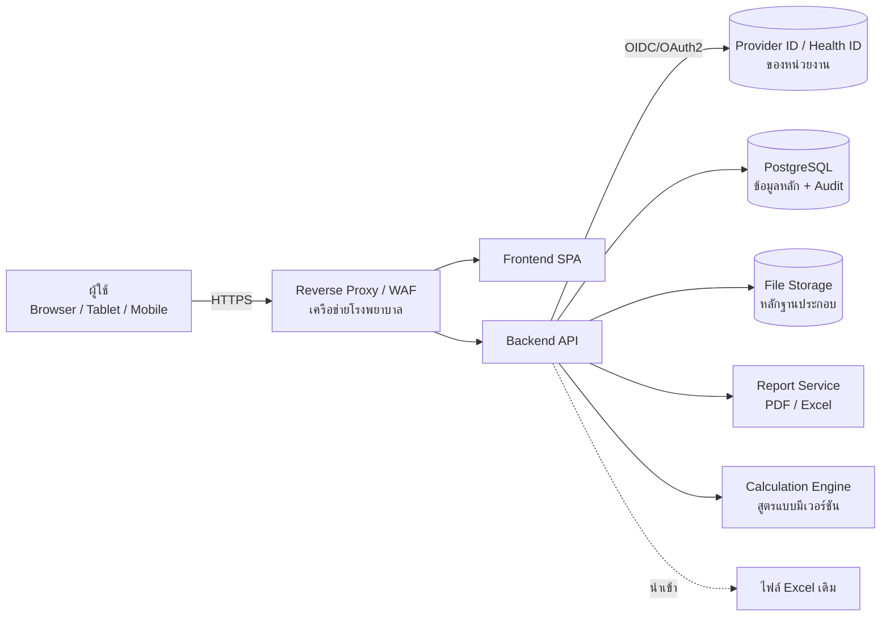

**หลักการ**
- **Calculation Engine แยกเป็นโมดูล** เก็บสูตร น้ำหนัก และเกณฑ์เป็น "ชุดสูตร (Formula Set) แบบมีเวอร์ชัน" ผลคะแนนทุกครั้งบันทึกเวอร์ชันสูตร ค่าข้อมูลที่ใช้ และค่าระหว่างทาง เพื่อให้ตรวจสอบที่มาของทุกคะแนนได้
- **Unit Test ทุกสูตรเทียบกับค่าใน Excel** (Golden Test) เช่น CT = 75.54, Ultrasound = 50.45, Ventilator = 52.25
- ติดตั้ง **On-premise / Private Cloud ของหน่วยงาน** ตามนโยบายข้อมูลโรงพยาบาล

## 2.2 User Roles

| บทบาท | หน้าที่ | ขอบเขตข้อมูล |
|---|---|---|
| Administrator | จัดการผู้ใช้ บทบาท หน่วยงาน ตั้งค่าระบบ เสนอเวอร์ชันสูตร ปลดล็อกข้อมูล | ทุกหน่วยงาน |
| Data Entry | เพิ่ม/แก้ไขทะเบียนครุภัณฑ์และข้อมูลรายปี (สถานะร่าง) ส่งตรวจ | เฉพาะหน่วยงานที่ได้รับมอบหมาย |
| Reviewer | ตรวจสอบ ยืนยัน หรือตีกลับพร้อมเหตุผล | ตามที่ได้รับมอบหมาย |
| Executive | ดู Dashboard รายงาน และส่งออก PDF/Excel | ทุกหน่วยงาน (อ่านอย่างเดียว) |

> ผู้ใช้ 1 คนมีได้หลายบทบาท แต่ระบบห้ามยืนยันข้อมูลที่ตนเองเป็นผู้บันทึก (Segregation of Duties)

## 2.3 Workflow

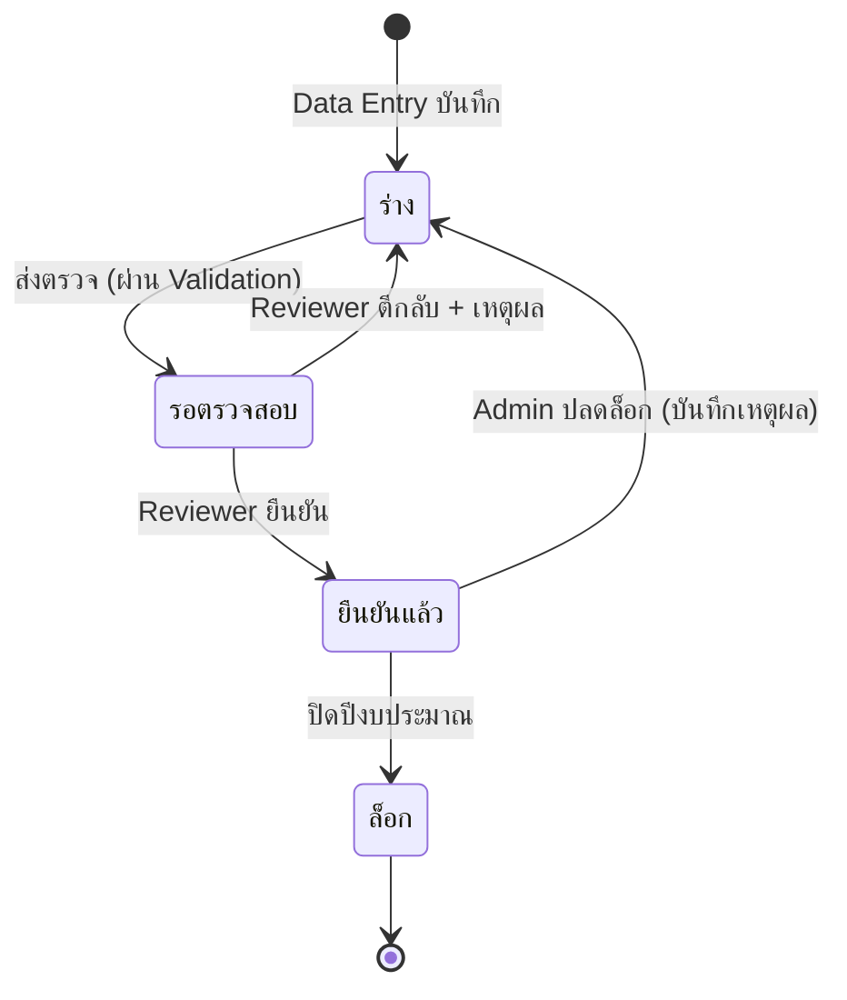

1. **Login** ด้วย Provider ID → ผู้ใช้ใหม่สถานะ "รออนุมัติ" → Admin กำหนดบทบาทและหน่วยงาน
2. **ลงทะเบียนครุภัณฑ์** (ข้อมูลพื้นฐาน 1 ครั้ง) และแนบหลักฐาน
3. **บันทึกข้อมูลรายปี** ทีละปีงบประมาณ ระบบตรวจสอบทันที → ส่งตรวจ
4. **Reviewer ยืนยัน** → ระบบคำนวณ Score อัตโนมัติด้วยชุดสูตรที่อนุมัติ
5. **Executive ดู** Dashboard, เปรียบเทียบ, ส่งออกรายงาน (เลือกได้ว่าใช้เฉพาะข้อมูลที่ยืนยันแล้ว)
6. การแก้ไขข้อมูลที่ยืนยันแล้วจะสร้าง **เวอร์ชันใหม่** โดยไม่เขียนทับเวอร์ชันเดิม

## 2.4 Data Flow

```mermaid
flowchart TD
  A[ทะเบียนครุภัณฑ์<br/>equipment] --> C
  B[ข้อมูลรายปี<br/>annual_record แยกปีงบ] -->|Validation| B2{ยืนยันแล้ว?}
  B2 -- ใช่ --> C[รวมข้อมูล 5 ปี<br/>ตามวิธีที่อนุมัติ Q-02]
  F[ชุดสูตร/น้ำหนัก<br/>formula_set vX] --> D
  C --> D[Calculation Engine]
  D --> E[score_result<br/>คะแนน 6 ปัจจัย + ค่าระหว่างทาง + เวอร์ชัน]
  E --> G[Dashboard / ผลวิเคราะห์ / รายงาน PDF-Excel]
  B -. ทุกการเปลี่ยนแปลง .-> H[(audit_log)]
  A -. .-> H
  F -. .-> H
```

## 2.5 โครงสร้าง Module

| Module | ความสามารถหลัก |
|---|---|
| M1 Authentication & Authorization | OIDC กับ Provider ID, Session, RBAC + ขอบเขตหน่วยงาน |
| M2 Master Data | หน่วยงาน ประเภทครุภัณฑ์ ปีงบประมาณ สถานะ |
| M3 Equipment Registry | เพิ่ม แก้ไข ค้นหา ดูรายละเอียด ประวัติการประเมิน แนบเอกสาร นำเข้า Excel |
| M4 Annual Data Entry | แบบฟอร์มรายปี 4 หมวด, Validation, บันทึกร่าง, ประวัติซ่อมบำรุง |
| M5 Review & Approval | คิวรอตรวจ ยืนยัน ตีกลับ ล็อก/ปลดล็อก |
| M6 Calculation Engine | ชุดสูตรแบบมีเวอร์ชัน คำนวณสะสมและรายปี Golden Test กับ Excel |
| M7 Dashboard & Analytics | KPI, กราฟ 7 ชนิด, ตัวกรอง 6 ชนิด, เปรียบเทียบ |
| M8 Reports & Export | PDF สำหรับผู้บริหาร, Excel (รวมแผ่นแสดงสูตร) |
| M9 Audit Trail | บันทึกทุกการสร้าง แก้ไข ยืนยัน ส่งออก และเข้าสู่ระบบ |
| M10 Administration | ผู้ใช้ บทบาท ชุดสูตร (อนุมัติ 2 ชั้น) การตั้งค่า |

## 2.6 แนวทางเชื่อมต่อ Provider ID

**สิ่งที่ทราบ (ต้องยืนยันกับผู้ดูแลระบบ):** จากการค้นหาเบื้องต้น การเชื่อมต่อ Provider ID ของกระทรวงสาธารณสุขที่มีผู้อธิบายไว้เป็น OAuth 2.0 แบบ 2 ขั้น คือยืนยันตัวตนผ่าน **Health ID (moph.id.th)** แล้วนำ token ไปขอข้อมูลบุคลากรจาก **provider.id.th** แหล่งข้อมูลที่พบเป็นเอกสารของชุมชน **ไม่ใช่เอกสารทางการ** จึงยังไม่ใช้อ้างอิงในการพัฒนา

**แนวทางที่เสนอ**
- ใช้ **Authorization Code Flow + PKCE** ฝั่ง Backend (Confidential Client) โดย Client Secret อยู่เฉพาะ Server
- ระบบ **ไม่รับ ไม่เห็น และไม่เก็บรหัสผ่าน** ผู้ใช้กรอกรหัสผ่านที่หน้าของผู้ให้บริการเท่านั้น
- เก็บเฉพาะ Provider ID, ชื่อ, หน่วยงาน และเวลาเข้าใช้ ส่วน Access/Refresh token เก็บฝั่ง Server แบบเข้ารหัส หรือไม่เก็บถ้าไม่จำเป็น
- **บทบาทกำหนดในระบบนี้** (ไม่พึ่งข้อมูลตำแหน่งจาก Provider ID เพียงอย่างเดียว)
- ระหว่างรอเอกสาร: หน้า Login เป็น **Mockup** และสภาพแวดล้อมพัฒนาใช้ Identity Provider จำลอง (เช่น Keycloak ภายใน) ที่ติดป้ายชัดว่า "ไม่ใช่ Provider ID จริง"

**สิ่งที่ต้องขอจากผู้ดูแลระบบ / สำนักงานสุขภาพดิจิทัล**
1. เอกสาร API/OIDC ทางการ (Authorization, Token, UserInfo/Profile endpoints, Discovery URL ถ้ามี)
2. การลงทะเบียน Client: `client_id`, `client_secret` แยก Test และ Production
3. Redirect URI ที่อนุญาต และโดเมนของระบบ
4. Scope และ Claims ที่ได้รับ (Provider ID, ชื่อ, เลขใบประกอบวิชาชีพ, รหัสหน่วยงาน/HCODE, ตำแหน่ง)
5. สภาพแวดล้อมทดสอบ (Sandbox) และบัญชีทดสอบ
6. นโยบาย Token (อายุ, Refresh, Revoke) และ Logout
7. เงื่อนไขการใช้งาน/ข้อตกลงการใช้ข้อมูล (PDPA) และขั้นตอนขออนุมัติ
8. ช่องทางติดต่อและ SLA กรณีระบบยืนยันตัวตนขัดข้อง

---

# Deliverable 3: UI/UX Design

**แนวทางที่ใช้:** โทนขาว–น้ำเงิน–ฟ้าแบบระบบสารสนเทศโรงพยาบาล, ฟอนต์ IBM Plex Sans Thai (รองรับภาษาไทย ตัวเลขอ่านง่าย), ตัวอักษรพื้นฐาน 15px, สีสถานะ เขียว = ดี / น้ำเงิน = ดี (60–79) / เหลือง = เฝ้าระวัง / แดง = ต้องดำเนินการ, ตัวเลขจัดแนวตาราง (tabular numbers), ทุกหน้ามีป้าย **"ข้อมูลตัวอย่าง (DEMO)"**

> Score ในภาพทั้งหมดคำนวณด้วยสูตร Excel ต้นฉบับจริง (ข้อ 1.4) จากข้อมูล DEMO แถว DEMO-001 ถึง 003 ใช้ค่าตัวอย่างเดียวกับในไฟล์ A จึงได้ 75.5 / 50.4 / 52.3 ตรงกับ Excel

## หน้า 1 — Login ด้วย Provider ID
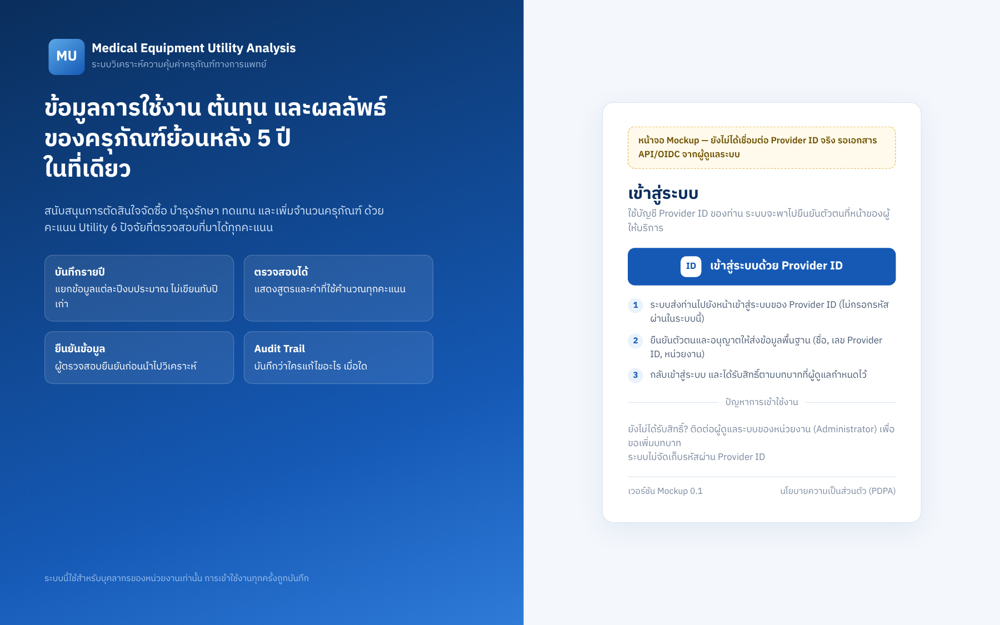
- ปุ่มเดียว "เข้าสู่ระบบด้วย Provider ID" ระบบ redirect ไปหน้าของผู้ให้บริการ **ไม่มีช่องรหัสผ่าน**
- แสดงขั้นตอน 3 ขั้น และป้ายเตือนว่าเป็น Mockup ที่ยังไม่เชื่อมต่อจริง
- **Workflow:** กดปุ่ม → ยืนยันตัวตนที่ Provider ID → กลับมาพร้อมบทบาท หรือสถานะ "รออนุมัติ"

## หน้า 2 — Dashboard ภาพรวม
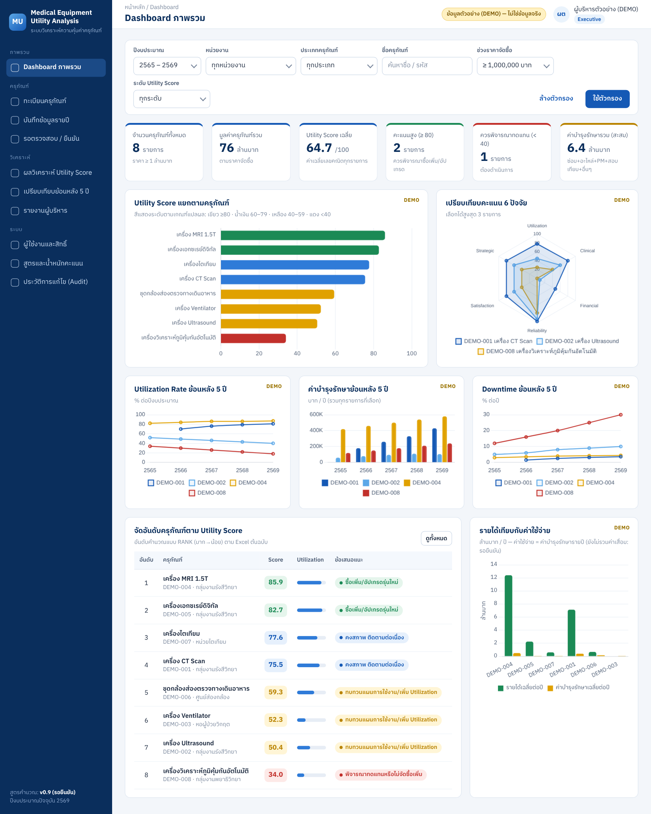
- ตัวกรอง 6 ชนิด: ปีงบประมาณ, หน่วยงาน, ประเภท, ชื่อ, ช่วงราคา, ระดับ Score
- KPI 6 การ์ด: จำนวน, มูลค่ารวม, Score เฉลี่ย, คะแนนสูง (≥80), ควรพิจารณาทดแทน (<40), ค่าบำรุงรักษารวม (แถบสีบนการ์ดบอกสถานะ)
- กราฟ 7 ชนิด: Score รายครุภัณฑ์ (สีตามเกณฑ์), Radar 6 ปัจจัย, Utilization 5 ปี, ค่าบำรุงรักษา 5 ปี, Downtime 5 ปี, ตารางจัดอันดับ, รายได้เทียบค่าใช้จ่าย
- คลิกแถวใดก็ได้เพื่อไปหน้ารายละเอียด (หน้า 7)

## หน้า 3 — ทะเบียนครุภัณฑ์
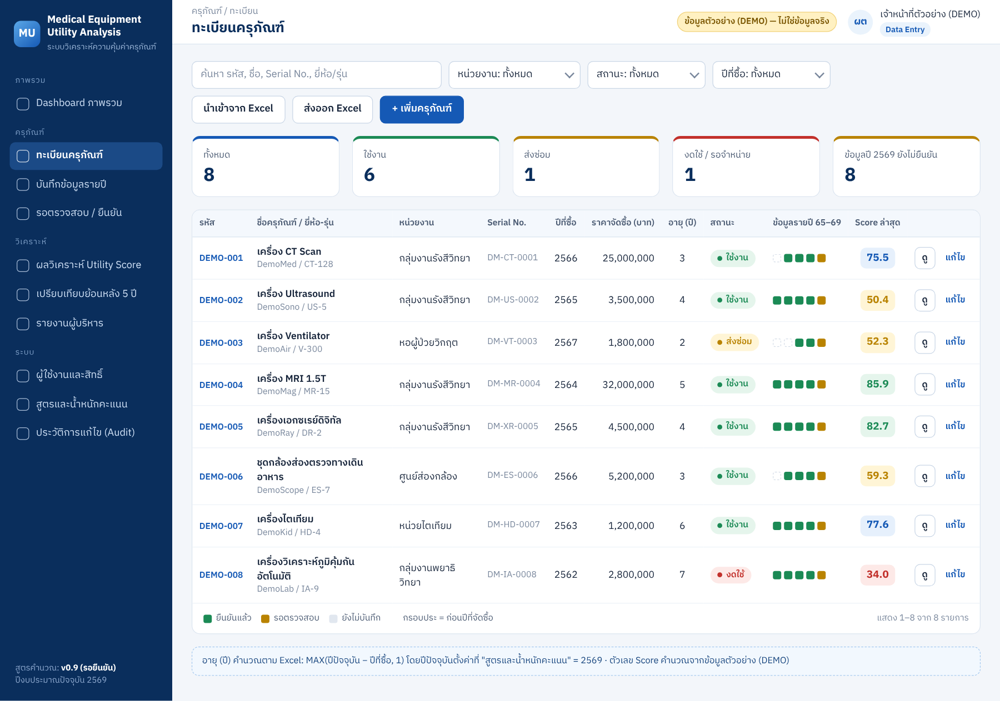
- ค้นหาด้วยรหัส, ชื่อ, Serial หรือยี่ห้อ/รุ่น และกรองตามหน่วยงาน/สถานะ/ปี นำเข้าและส่งออก Excel ได้
- คอลัมน์ "ข้อมูลรายปี 65–69" แสดงความครบถ้วนของข้อมูลแต่ละปี (เขียว = ยืนยัน, เหลือง = รอตรวจ, เทา = ยังไม่บันทึก, กรอบประ = ก่อนปีจัดซื้อ)

## หน้า 4 — เพิ่ม / แก้ไขครุภัณฑ์
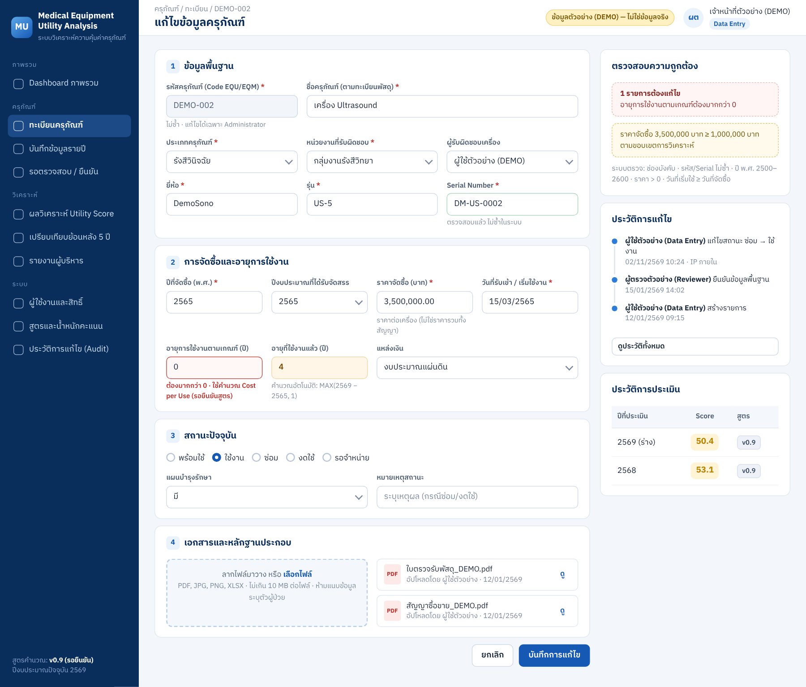
- 4 หมวด: ข้อมูลพื้นฐาน, การจัดซื้อและอายุ, สถานะ, เอกสารหลักฐาน ช่องบังคับมี \* ช่องคำนวณอัตโนมัติเป็นสีส้มอ่อน (อ่านอย่างเดียว)
- แผงขวา: ผลตรวจความถูกต้อง, ประวัติการแก้ไข (ใคร/อะไร/เมื่อใด), ประวัติการประเมินพร้อมเวอร์ชันสูตร
- **ข้อมูลพื้นฐานแยกจากข้อมูลรายปี** ตามข้อกำหนดข้อ 5

## หน้า 5 — แบบฟอร์มบันทึกข้อมูลรายปี
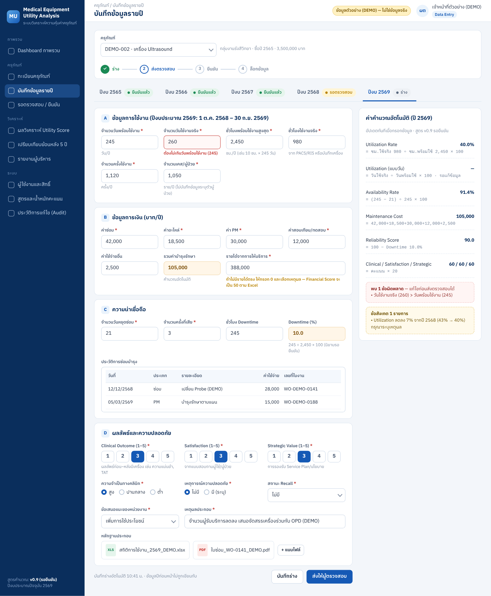
- แท็บปีงบประมาณ 2565–2569 แต่ละปีมีสถานะของตัวเอง แก้ไขปีหนึ่งไม่กระทบปีอื่น
- 4 หมวด: การใช้งาน, การเงิน, ความน่าเชื่อถือ (รวมประวัติซ่อมบำรุง), ผลลัพธ์และความปลอดภัย (คะแนน 1–5, Recall, เหตุการณ์ความปลอดภัย, ความจำเป็นทางคลินิก, ข้อเสนอแนะหน่วยงาน, หลักฐาน)
- แผงขวา "ค่าคำนวณอัตโนมัติ" แสดงสูตรพร้อมตัวเลขจริงทุกบรรทัด, **ข้อผิดพลาด** (สีแดง ส่งตรวจไม่ได้) และ **ข้อสังเกต** (สีเหลือง ต้องระบุเหตุผล)
- แถบขั้นตอน: ร่าง → ส่งตรวจสอบ → ยืนยัน → ล็อก

## หน้า 6 — ผลการวิเคราะห์ Utility Score
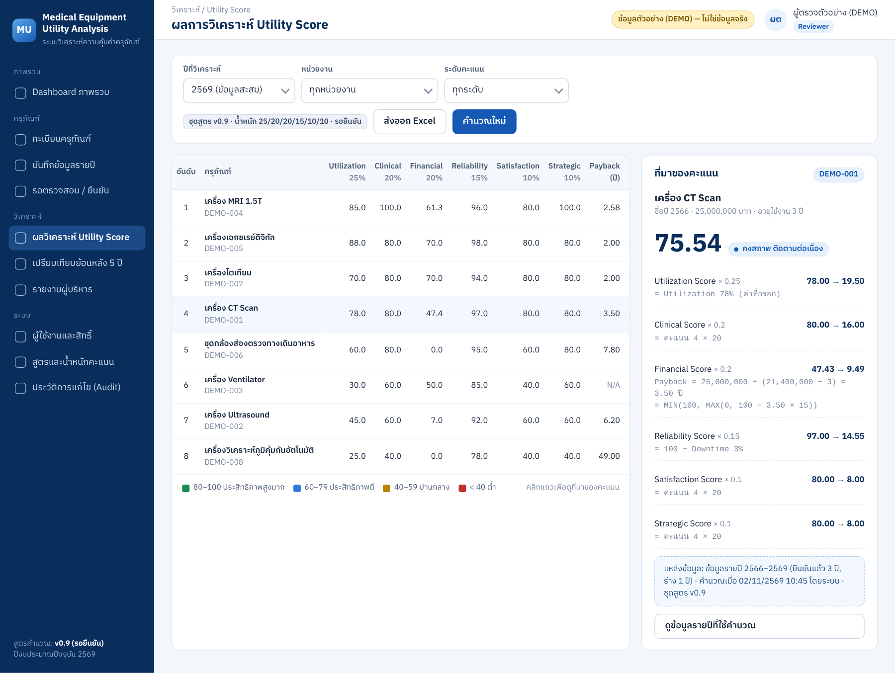
- ตารางคะแนน 6 ปัจจัย (แสดงน้ำหนักบนหัวคอลัมน์), Payback และ Score รวม พร้อมป้ายเวอร์ชันชุดสูตร
- **แผง "ที่มาของคะแนน"** แสดงสูตรและตัวเลขที่ใช้ของแต่ละปัจจัย คะแนน × น้ำหนัก แหล่งข้อมูล (ปีใด สถานะใด) และเวลาที่คำนวณ ตามข้อกำหนดข้อ 6–7

## หน้า 7 — รายละเอียดและเปรียบเทียบย้อนหลัง 5 ปี
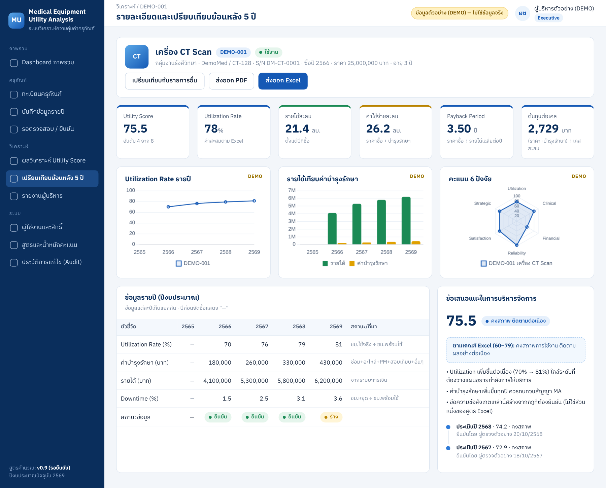
- ข้อมูลพื้นฐาน, KPI 6 ค่า (Score, Utilization, รายได้สะสม, ค่าใช้จ่ายสะสม, Payback, ต้นทุนต่อเคส)
- กราฟแนวโน้มรายปี, Radar, ตารางข้อมูล 5 ปีพร้อมสถานะของแต่ละปี
- ข้อเสนอแนะตามเกณฑ์ Excel แยกจากข้อสังเกตเชิงแนวโน้ม (ระบุชัดว่าข้อสังเกตเป็นกฎที่ต้องยืนยัน) และประวัติการประเมินในปีก่อน ๆ

## หน้า 8 — รายงานสำหรับผู้บริหาร
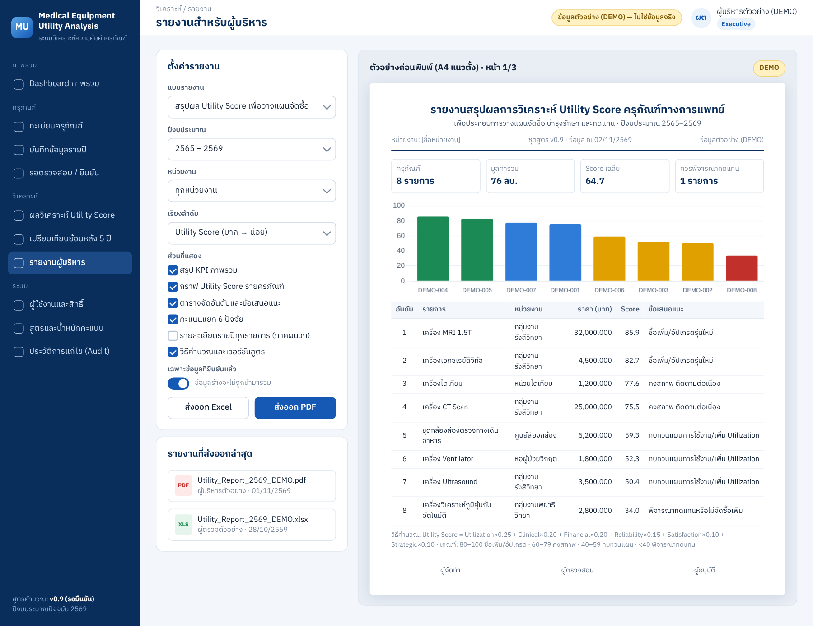
- เลือกแบบรายงาน ปี หน่วยงาน การเรียงลำดับ และส่วนที่ต้องแสดง มีสวิตช์ "เฉพาะข้อมูลที่ยืนยันแล้ว"
- ตัวอย่าง A4: KPI, กราฟ, ตารางจัดอันดับ, วิธีคำนวณ, เวอร์ชันสูตร และช่องลงนาม ผู้จัดทำ/ผู้ตรวจสอบ/ผู้อนุมัติ
- ส่งออก PDF และ Excel (ไฟล์ Excel มีชีตแสดงสูตรและค่าที่ใช้)

## หน้า 9 — จัดการผู้ใช้งานและสิทธิ์
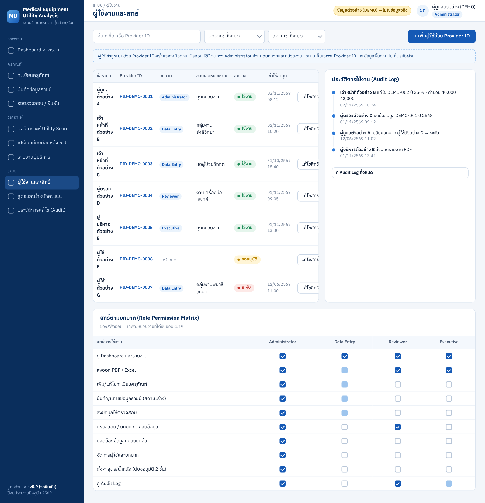
- รายชื่อผู้ใช้ตาม Provider ID, บทบาท, ขอบเขตหน่วยงาน, สถานะ (ใช้งาน/รออนุมัติ/ระงับ)
- Audit Log ล่าสุด และตาราง **Role Permission Matrix** 10 สิทธิ์ × 4 บทบาท

## Responsive (Mobile)
| Dashboard (390px) | บันทึกข้อมูล (390px) |
|---|---|
| 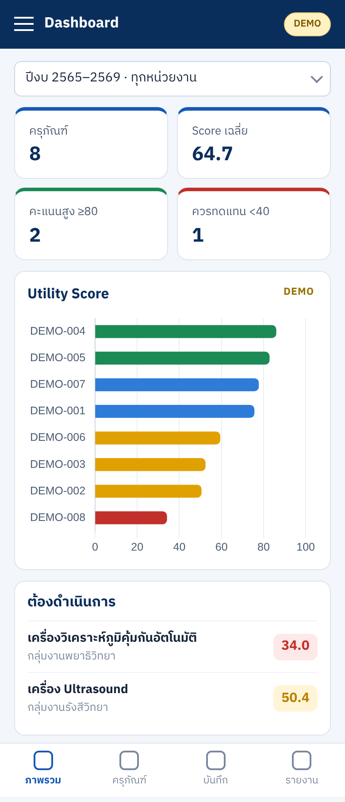 | 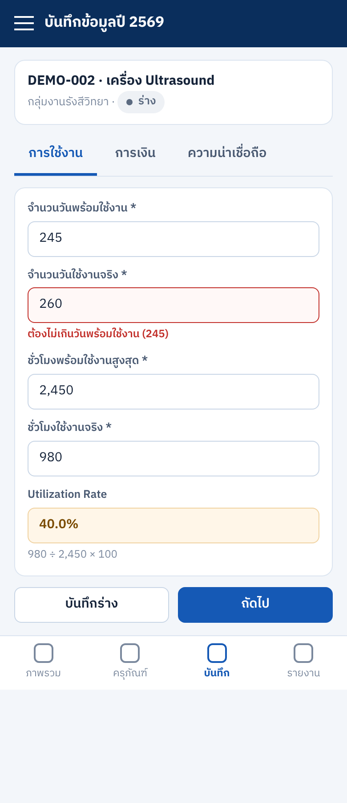 |

- Desktop ≥1280px: Sidebar + Grid 6 คอลัมน์ / Tablet 768–1279px: Sidebar ย่อเป็นไอคอน, Grid 2–3 คอลัมน์ / Mobile <768px: เมนูล่าง 4 ปุ่ม, การ์ด 2 คอลัมน์, ฟอร์มแบ่งเป็นแท็บทีละหมวด และตารางกว้างเลื่อนแนวนอนในกรอบของตัวเอง

---

# Deliverable 4: Development Plan

## 4.1 เทคโนโลยีที่แนะนำ

| ชั้น | เทคโนโลยี | เหตุผล |
|---|---|---|
| Frontend | React + TypeScript (Vite), UI Library ที่รองรับ Accessibility, Chart.js/ECharts | ระบบนิเวศใหญ่ และกำหนด Type ของข้อมูลคะแนนได้ชัด |
| Backend | NestJS (TypeScript) **หรือ** Laravel (PHP) ตามความถนัดของทีม IT ของหน่วยงาน | มี RBAC, Validation และ ORM พร้อม |
| Database | PostgreSQL 16 | รองรับ JSONB สำหรับค่าระหว่างทางของการคำนวณ, Row-level security และ Audit |
| Auth | OIDC Client (openid-client / Laravel Socialite) กับ Provider ID | มาตรฐาน OAuth2/OIDC |
| Report | PDF: Headless Chromium หรือ Puppeteer (รองรับฟอนต์ไทย) / Excel: ExcelJS หรือ PhpSpreadsheet | รายงานภาษาไทยแสดงผลถูกต้อง |
| Deploy | Docker Compose บน Server ภายในโรงพยาบาล + Nginx | ดูแลง่าย ข้อมูลอยู่ในหน่วยงาน |

## 4.2 โครงสร้างฐานข้อมูลเบื้องต้น

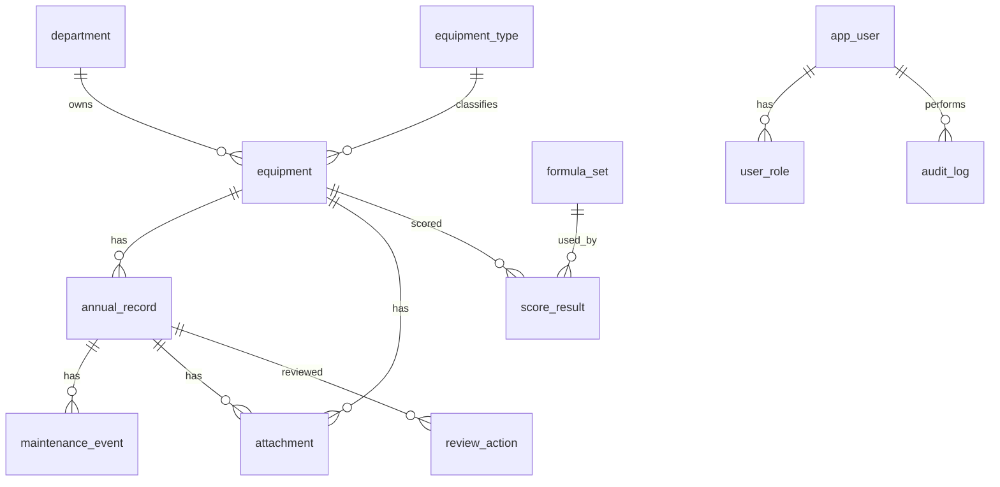

| ตาราง | ฟิลด์หลัก |
|---|---|
| `equipment` | id, code (unique), name, type_id, department_id, brand, model, serial_no (unique), purchase_year_be, purchase_price, contract_no, received_date, start_date, useful_life_years, status, maintenance_plan, created_by, updated_by, version |
| `annual_record` | id, equipment_id, fiscal_year_be (unique ต่อ equipment), available_days, actual_days, max_available_hours, actual_hours, use_count, case_count, repair_cost, parts_cost, pm_cost, calibration_cost, other_cost, revenue, no_direct_revenue_flag, repair_days, breakdown_count, downtime_hours, clinical_score, satisfaction_score, strategic_score, clinical_necessity, safety_event, safety_detail, recall_status, unit_recommendation, rationale, **status** (draft/submitted/approved/locked), version |
| `maintenance_event` | id, annual_record_id, date, type (ซ่อม/PM/สอบเทียบ), detail, cost, work_order_no |
| `formula_set` | id, version, weights (JSON), payback_penalty, thresholds (JSON), definitions (JSON), status (draft/approved/retired), approved_by, approved_at |
| `score_result` | id, equipment_id, formula_set_id, period_from, period_to, basis (cumulative/annual), inputs_snapshot (JSON), intermediate (JSON: age, payback, cpc, 6 scores), utility_score, rank, recommendation, computed_at |
| `attachment` | id, owner_type, owner_id, filename, mime, size, sha256, storage_key, uploaded_by |
| `app_user` / `user_role` | provider_id (unique), name, department_id, status / role, department_scope |
| `review_action` | record_id, action (submit/approve/reject/unlock), reason, actor, at |
| `audit_log` | id, actor_id, action, entity, entity_id, before (JSON), after (JSON), ip, user_agent, at (append-only) |

> ข้อมูลรายปีกับข้อมูลพื้นฐานอยู่คนละตาราง และ `score_result` เก็บ snapshot ของ input ทำให้ตรวจสอบย้อนหลังได้แม้ข้อมูลจะถูกแก้ไขภายหลัง

## 4.3 แนวทางพัฒนา Backend และ Frontend

**Backend**
- Calculation Engine เป็น Pure Function `score(inputs, formulaSet) → {intermediates, scores, total}` ไม่มี side effect ทดสอบได้ 100%
- Golden Test เทียบกับค่าในไฟล์ A ทุกแถว ต้องตรงที่ทศนิยม 6 ตำแหน่ง
- Validation 2 ชั้น (Frontend + Backend) เช่น วันใช้จริง ≤ วันพร้อมใช้, ชม.ใช้จริง ≤ ชม.พร้อมใช้, คะแนน 1–5, ค่าเงิน ≥ 0, ปี พ.ศ. 2500–2600, ไม่ซ้ำปีงบต่อเครื่อง และแจ้งเตือนเมื่อค่าเปลี่ยนจากปีก่อนเกิน ±30%
- Optimistic locking (field `version`) ป้องกันการบันทึกทับกัน
- API ตรวจสิทธิ์ตามบทบาทและขอบเขตหน่วยงานทุก endpoint

**Frontend**
- Design tokens ตาม Mockup (สี ฟอนต์ ระยะ) และ Component กลาง (KPI Card, Score Badge, Status Chip, Calc Line)
- ฟอร์มรายปีบันทึกร่างอัตโนมัติ และคำนวณตัวอย่างฝั่ง Client ด้วยไลบรารีสูตรชุดเดียวกับ Backend
- ทุกตัวเลขคะแนนคลิกดู "ที่มาของคะแนน" ได้

**ระยะการพัฒนา (หลังได้รับอนุมัติ)**

| Sprint | งาน |
|---|---|
| 0 | ยืนยันประเด็น Q-01 ถึง Q-15 และอนุมัติชุดสูตร v1.0 |
| 1 | โครงสร้างโปรเจกต์, DB, Auth (IdP จำลอง), RBAC, Audit |
| 2 | ทะเบียนครุภัณฑ์ + เอกสารแนบ + นำเข้า Excel |
| 3 | ฟอร์มรายปี + Validation + Review Workflow |
| 4 | Calculation Engine + Golden Test + หน้าผลวิเคราะห์ |
| 5 | Dashboard + หน้ารายละเอียด 5 ปี |
| 6 | รายงาน PDF/Excel + การจัดการผู้ใช้ |
| 7 | เชื่อม Provider ID จริง (เมื่อได้เอกสาร), Security test, UAT |

## 4.4 แนวทางรักษาความปลอดภัย

- **PDPA และข้อมูลโรงพยาบาล:** ไม่บันทึกข้อมูลระบุตัวผู้ป่วย (เก็บเฉพาะจำนวนเคส) และแจ้งเตือนเมื่อแนบไฟล์ว่าห้ามมีข้อมูลผู้ป่วย
- HTTPS (TLS 1.2+), HSTS, CSP, Secure/HttpOnly/SameSite cookies
- ไม่เก็บรหัสผ่าน, Secret อยู่ใน Vault หรือ Environment ของ Server, หมุนเวียน Secret ได้
- RBAC + ขอบเขตหน่วยงาน (Row-level), Segregation of Duties (ผู้บันทึกยืนยันข้อมูลของตนเองไม่ได้)
- Audit log แบบ append-only และป้องกันการแก้ไข (เช่น hash chain)
- เข้ารหัสข้อมูลขณะจัดเก็บ (DB/Storage), สแกนไวรัสไฟล์แนบ, จำกัดชนิดและขนาดไฟล์
- ป้องกัน OWASP Top 10 (SQLi, XSS, CSRF, IDOR), Rate limit, Session timeout
- สำรองข้อมูลรายวัน เข้ารหัส และทดสอบกู้คืนรายไตรมาส

## 4.5 แผนการทดสอบระบบ

| ระดับ | สิ่งที่ทดสอบ |
|---|---|
| Unit | สูตรทุกตัว + Golden Test กับ Excel + Edge cases (รายได้ 0, เคส 0, ปีที่ซื้อ = ปีปัจจุบัน, ข้อมูลไม่ครบ) |
| Integration | API + DB + สิทธิ์ตามบทบาท/หน่วยงาน, Workflow ร่าง → ยืนยัน → ล็อก |
| E2E | Playwright: Login (IdP จำลอง), บันทึกข้อมูลครบ 5 ปี, ส่งออกรายงาน |
| Reconciliation | นำข้อมูลไฟล์ B เข้า แล้วเทียบผลกับ Excel ทุกแถว (ยกเว้นแถวที่มีข้อผิดพลาด E-01 ถึง E-05 ซึ่งแยกรายงาน) |
| Security | OWASP ZAP, Dependency scan, Penetration test โดยหน่วยงานที่ได้รับอนุญาต |
| Usability / UAT | ผู้ใช้จริงแต่ละบทบาท ทดสอบบน Desktop, Tablet และ Mobile |
| Performance | 500 ครุภัณฑ์ × 5 ปี: Dashboard โหลดภายใน 2 วินาที |

## 4.6 แผนการนำขึ้นใช้งานจริง (ดำเนินการเมื่อได้รับอนุญาตเท่านั้น)

1. **Dev / Test / Production แยกกัน** Test ใช้ข้อมูล DEMO หรือข้อมูลที่ปกปิดแล้ว
2. ได้รับอนุมัติชุดสูตร v1.0 และเอกสาร Provider ID จากผู้ดูแลระบบ
3. นำเข้าข้อมูลจริงเป็น "ร่าง" และให้ Reviewer ยืนยัน
4. **Pilot** 1–2 หน่วยงาน 1 เดือน โดยใช้ Excel คู่ขนานเพื่อเทียบผล
5. อบรมผู้ใช้ตามบทบาท พร้อมคู่มือภาษาไทย
6. Go-live ทั้งหน่วยงาน มีแผน Rollback และสำรองข้อมูลก่อนขึ้นระบบ
7. ติดตาม Monitoring/Log และทบทวนชุดสูตรประจำปีโดยคณะกรรมการ

---

## สิ่งที่ต้องการจากท่านเพื่อไปขั้นตอนถัดไป
1. ยืนยันหรือแก้ไขประเด็น **Q-01 ถึง Q-15** (ข้อ 1.9)
2. ยืนยันว่าเซลล์ #REF! (E-01, E-02) ควรอ้างอิงอะไร และต้องการให้รายงานกลับไปยังเจ้าของไฟล์หรือไม่
3. ความเห็นต่อ Mockup ทั้ง 9 หน้า (+ Mobile)
4. ข้อมูล Provider ID ตามรายการในข้อ 2.6
5. ความถนัดของทีม IT (PHP/Laravel หรือ TypeScript/NestJS) และสภาพแวดล้อม Server

**ยังไม่ได้ดำเนินการ:** เขียนโปรแกรมระบบ, สร้างฐานข้อมูล, เชื่อมต่อ Provider ID, Deploy
